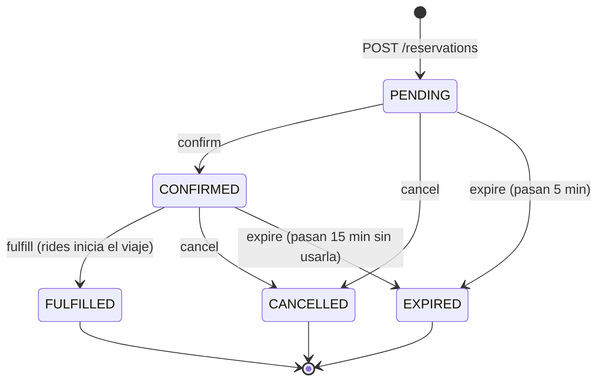

# Microservicio de reservas (`services/reservations`)

Crea, confirma, cancela y expira reservas, y garantiza que un vehículo no se reserva dos veces.
Puerto local: **8005** · Swagger: `http://localhost:8005/docs`

## Estados de una reserva



- **Activos:** `PENDING` y `CONFIRMED`. Bloquean el vehículo.
- **Finales:** `FULFILLED`, `CANCELLED` y `EXPIRED`. Ya no cambian.

Los plazos se configuran con `RESERVATION_TTL_MINUTES` (5 por defecto) y `CONFIRMED_HOLD_MINUTES` (15 por defecto).

## Endpoints

| Método | Ruta | Qué hace | Respuestas |
|---|---|---|---|
| POST | `/reservations` | Crea una reserva `PENDING` | 201, 404, 409, 422, 503 |
| GET | `/reservations?user_id=&status=` | Lista reservas (historial del usuario) | 200 |
| GET | `/reservations/{id}` | Consulta una reserva | 200, 404 |
| POST | `/reservations/{id}/confirm` | `PENDING` → `CONFIRMED` | 200, 404, 409 |
| POST | `/reservations/{id}/cancel` | Activa → `CANCELLED` | 200, 404, 409 |
| POST | `/reservations/{id}/expire` | Activa vencida → `EXPIRED` | 200, 404, 409 |
| POST | `/reservations/expire-overdue` | Expira todas las vencidas (Lambda) | 200 |
| POST | `/reservations/{id}/fulfill` | Activa → `FULFILLED` (lo llama rides) | 200, 404, 409 |
| GET | `/health` | Health check (comprueba la BD) | 200, 503 |

Cuerpo de `POST /reservations`:

```json
{"user_id": "U1", "vehicle_id": "S-1", "vehicle_type": "SCOOTER", "zone_id": "Z01"}
```

## Eventos que publica

| Evento | Cuándo | `data` |
|---|---|---|
| `VehicleReserved` | Al crear la reserva | `reservation_id`, `user_id`, `vehicle_id`, `vehicle_type`, `zone_id`, `expires_at` |
| `ReservationCancelled` | Al cancelar | `reservation_id`, `user_id`, `vehicle_id`, `zone_id` |
| `ReservationExpired` | Al expirar | `reservation_id`, `user_id`, `vehicle_id`, `zone_id` |

## Decisiones de diseño

**Cómo se evita la doble reserva.** La tabla tiene un índice único *parcial* sobre `vehicle_id` que solo cuenta las reservas activas. Si llegan dos reservas del mismo vehículo a la vez, la base de datos acepta la primera y rechaza la segunda (409). No se hace "comprobar y después insertar", porque entre los dos pasos podría colarse otra petición. Hay otro índice igual sobre `user_id`: un usuario solo puede tener una reserva activa.

**Cambios de estado atómicos.** Los cambios se hacen con `UPDATE ... WHERE status IN (...)`. Si una cancelación y una expiración llegan a la vez, solo una cambia la fila y solo se publica un evento.

**Idempotencia.** Cancelar una reserva ya cancelada, expirar una ya expirada o confirmar una ya confirmada devuelve la reserva sin publicar otro evento. Así la Lambda de expiración puede reintentar sin generar duplicados.

**Degradación si la Lambda falla.** Si la Lambda de expiración no se ejecuta, una reserva vencida se expira igualmente cuando alguien intenta confirmarla o usarla.

**Comprobación de disponibilidad.** Si `AVAILABILITY_URL` está configurada, al reservar se consulta `GET {AVAILABILITY_URL}/vehicles/{id}` con un timeout de 2 s.
- Si availability no responde, se rechaza la reserva con 503 en lugar de reservar a ciegas.
- Si la variable no está configurada, no se comprueba. Es el caso actual, hasta que availability exponga ese endpoint.

**Primero guardar, después publicar.** La reserva se guarda en la BD antes de publicar el evento. Si el bus falla, la librería común reintenta y deja el evento en el *outbox*.
